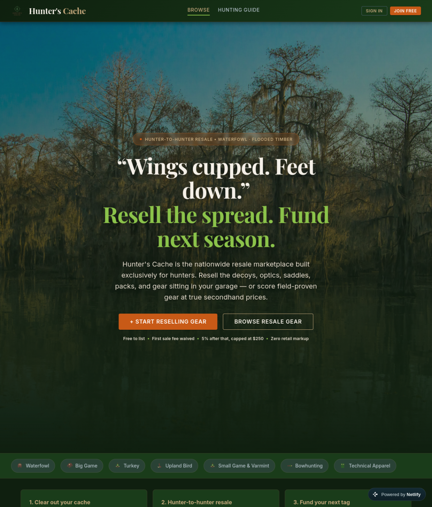
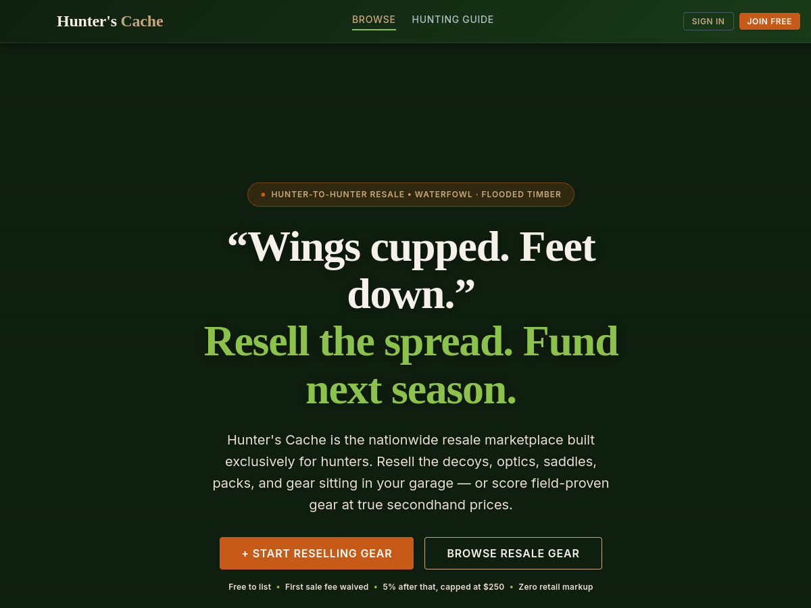

# Hunter's Cache

**A nationwide hunting gear resale marketplace built for hunters across game, season, and region.** This project combines a polished customer experience with the marketplace, security, and operations foundations needed to support a real product.

[Live website](https://hunterscacheusa.com/) · [GitHub repository](https://github.com/htxbby313/hunters-cache)

## Website screenshots

### Homepage



### Homepage at a glance



*Screenshots captured from the public production site on November 20, 2026.*

## What I built

- A responsive marketplace for browsing and listing pre-owned hunting gear.
- Discovery organized around game, season, terrain, and region.
- Seller profiles and buyer–seller messaging.
- Authentication and authorization for account, listing, and messaging flows.
- Operations foundations for moderation, disputes, verification records, and audit events.
- Evidence-based market-price research and honest empty states rather than seeded sales or reviews.

## Technology

| Area | Stack |
| --- | --- |
| Frontend | React 19, Vite, JavaScript, CSS |
| API | Node.js, Express, serverless-http |
| Data | PostgreSQL in production; SQLite for local development |
| Hosting | Netlify static hosting and Functions |
| Security | JWT authentication, bcrypt password hashing, server-side provider credentials |

## Architecture and engineering

The React client builds into `dist/`. Express API routes run locally with Node and are adapted to Netlify Functions for production. `netlify.toml` routes API requests to the serverless API and publishes the built client. PostgreSQL is used when `DATABASE_URL` is configured; local development can use SQLite.

The codebase includes validation and operational safeguards around sensitive marketplace workflows. Provider credentials stay server-side, and checkout remains gated until payment, fulfillment, policy, and end-to-end transaction requirements are met.

## Run locally

Requirements: Node.js 22 or later and npm.

```powershell
npm install
npm run dev
```

Build the production frontend with:

```powershell
npm run build
```

For the Express server, copy `.env.example` to `.env`, set local values, then run:

```powershell
npm run server
```

Never commit `.env` files or production credentials. Configure real secrets through the hosting platform.

## Project status

Hunter's Cache is in a browsing-and-listing beta. The production site is publicly accessible, while paid and firearm checkout remain disabled pending provider, compliance, storage, and operational launch gates. A deployed website does not by itself establish transaction readiness. See [`LAUNCH_CHECKLIST.md`](LAUNCH_CHECKLIST.md) and [`OPERATIONS.md`](OPERATIONS.md) for current project boundaries.

## Copyright and reuse

Original Hunter's Cache source code and project materials are **Copyright © 2026 Tay Coleman. All rights reserved.** No license is granted to copy, modify, redistribute, or create derivative works from those materials. Third-party libraries and assets remain subject to their own licenses and terms.

This public repository can still be viewed and forked through GitHub under GitHub's platform terms; that does not grant broader reuse rights. See [`LICENSE`](LICENSE).
